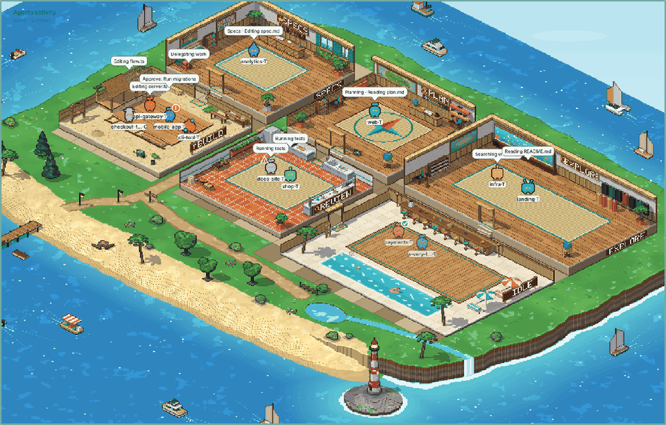

# Busybots

An isometric pixel-art board that shows what your coding agents are doing right now. Each Claude Code, Codex CLI, Gemini CLI, OpenCode, Cursor CLI or Conductor session is a little character that walks between rooms (Specs, Plan, Explore, Build, Test & Review, Idle) as its work changes, with a speech bubble saying what it's doing.



Four themes: **Island**, **Office**, **City** and **Space**.

> Status: early. Works on macOS and Linux; Windows should work but is less tested.

## Run

Requires **Node.js 22.5 or newer** (it uses Node's built-in SQLite). No other dependencies.

```bash
npx busybots               # starts the board and opens http://127.0.0.1:8765/
```

Then open **Settings** (top right, or http://127.0.0.1:8765/admin) to check that your agents were found. To keep it running in the background and start it at login, install it once with `npm install -g busybots` and run `busybots service install`.

From a clone instead: `git clone https://github.com/youmdingding/busybots.git && cd busybots && node bin/cli.js`.

| Command | What it does |
|---|---|
| `busybots` / `busybots start` | run the board and open it in your browser |
| `busybots serve` | same, without opening the browser |
| `busybots doctor` | check Node, your settings and every agent folder |
| `busybots status` | one pass of the watcher, printed as JSON |
| `busybots service install` | start the board at login (LaunchAgent on macOS, systemd user unit on Linux); `service uninstall` removes it |
| `busybots hook` | optional Claude Code hook, see [Status badges](#status-badges) |

Options: `--port N` (default 8765), `--no-open`. With `npx`, prefix them: `npx busybots doctor`. From a clone, run `node bin/cli.js <command>`.

Everything the board writes (settings, API token, logs, a copy of the current status) lives in a per-user folder, never in the repo: `~/Library/Application Support/busybots` on macOS, `$XDG_STATE_HOME/busybots` (default `~/.local/state/busybots`) on Linux, `%LOCALAPPDATA%\busybots` on Windows. Override with `BUSYBOTS_STATE`, or just the settings file with `BUSYBOTS_SETTINGS`.

## Rooms

Back row: **Specs → Plan → Explore** · Front row: **Build → Test & Review → Idle**.

- What an agent is doing (editing, running tests, reading, planning…) decides its room.
- Reading, searching and web lookups go to **Explore** — unless the current turn has already done other work, in which case reads stay with that work so implementing agents don't bounce between rooms.
- Room layout, labels, colours and the tool → room mapping live in `config.json`.

### Skill-aware rooms

A turn started with a skill or slash command keeps that skill's room for the whole turn, even while its sub-agents read files and run commands — e.g. `/plan` stays in **Plan**, `/pr-review` in **Test & Review**, `/spec-kit` in **Specs**. The bubble is prefixed ("Planning · Running a command"). Add your own skills with `rules.skillAreas` (see Configuration).

## Settings

The **Settings** page (`/admin`) is where you tell the board where your agents keep their sessions. It checks each folder as you type ("Found — 2 live sessions" / "Folder not found") and saves to `settings.json` in your state folder (see [Run](#run)). The watcher re-reads it every poll, so changes show up within seconds — no restart.

| Agent | What to point it at | Default |
|---|---|---|
| Claude Code | folder containing `sessions/` and `projects/` — add several if you use more than one profile | `~/.claude` (or `$CLAUDE_CONFIG_DIR`) |
| Codex CLI | folder containing `sessions/` | `~/.codex` (or `$CODEX_HOME`) |
| Gemini CLI | its `.gemini` folder (contains `tmp/`) | `~/.gemini` (or `$GEMINI_CLI_HOME/.gemini`) |
| OpenCode | its data folder (contains `opencode.db`) | `~/.local/share/opencode` (or `$XDG_DATA_HOME/opencode`) |
| Cursor CLI *(beta)* | its `.cursor` folder (contains `chats/`) | `~/.cursor` |
| Conductor | its app database (macOS); **Auto** turns it on when the file exists | `~/Library/Application Support/com.conductor.app/conductor.db` |

It also sets the board's default theme, whether idle agents keep their last bubble, how often it updates, and **privacy mode**: for screen sharing or streaming, agents show as "Claude 1", "Codex 2"… with generic bubbles ("Working on code", "Running checks", "Needs you"), and no project names, paths, file names or agent text leave the watcher; the agent panel hides its transcript. Without a `settings.json` the defaults above are used.

### What each agent's files can tell the board

Claude Code is the richest source. The others are read from their session files, which record less:

| | Rooms & bubbles | Done badge | Stuck badge | "Needs you" badge | Agent panel transcript |
|---|---|---|---|---|---|
| Claude Code | ✓ | ✓ | ✓ | ✓ | ✓ (and reply box) |
| Codex CLI | ✓ | ✓ | ✓ | — | ✓ |
| Gemini CLI | ✓ ¹ | ✓ | ✓ | — | ✓ |
| OpenCode | ✓ | ✓ | ✓ | — | ✓ |
| Cursor CLI | ✓ ² | ✓ | ✓ | — | ✓ |

- None of these agents writes "waiting for your approval" to disk, so only Claude Code gets the **needs you** badge.
- Agents other than Claude Code appear while their files are changing and stay (idle) for the number of minutes set in Settings.
- ¹ Gemini CLI writes a tool call only once it has finished, so while a command runs the agent shows its last message, and a turn counts as finished after ~45 s of quiet.
- ² Cursor's CLI is closed source; its reader follows the layout documented by community tools and may need updating when Cursor changes it. The Cursor IDE's own chats aren't read.

### Adding another agent

Each agent has a small reader in `src/readers/<agent>.js` that translates its session files into the Claude-style events the watcher already understands (event helpers in `src/events.js`, registry in `src/readers/index.js`). The scenarios in `tests/scenarios/` describe real on-disk formats and the board output they must produce; add one for a new agent and run `npm test`. See `AGENTS.md` for the full checklist.

## Configuration

`config.json` (shipped with the board) holds the room layout (`areas`, `pathHubs`), the tool → room mapping (`activityAreas`) and default rules. Your own additions go in the `rules` section of your `settings.json`, so they survive updates:

```json
{
  "rules": {
    "skillAreas":   { "brainstorming": "specs", "writing-plans": "plan", "ship": "build" },
    "skillLabels":  { "brainstorming": "Brainstorming", "ship": "Shipping" },
    "phaseFiles":   { "plan": ["research.md", "data-model.md"], "spec": ["brief.md"] },
    "testCommands": ["just check", "make verify"]
  }
}
```

- `skillAreas` / `skillLabels` — extra skills or slash commands and the room / bubble prefix they get (built-in defaults cover common names like `plan`, `review`, `explore`).
- `phaseFiles` — file names that mean an agent is writing a plan or a spec.
- `testCommands` — extra commands that count as testing (Test & Review room).

Both files are re-read every poll; a broken `settings.json` falls back to defaults.

## Status badges

The header shows a summary pill ("2 need you · 1 done"), and each agent can carry a badge:

- **!** (orange, pulsing) — *needs you*: a permission prompt, a question, or a plan waiting for approval.
- **✓** (green) — *done*: the last turn finished after editing files and you haven't replied yet.
- **⚠** (red) — *stuck*: 3+ failing tool calls in a row while still working.
- **orbiting dots** — *delegating*: live sub-agents.

Detection is heuristic from the transcripts. For exact permission detection, add the `Notification` hook from `examples/claude-hooks.json` to your Claude Code settings (it runs `busybots hook`).

## Agent panel

Click an agent to open its panel: the last 15 messages between you and the agent (with the tool steps in between, each with its date and time), **Jump to it** (brings its Terminal/iTerm tab or Conductor to the front, macOS) and, for idle terminal sessions, a prompt box that runs `claude --resume <id> -p "<prompt>"`.

Click ✎ next to the name to rename that conversation (it defaults to the folder name; **Use the default name** goes back). Click the agent's icon in the panel to give that conversation a different look: pick a character (its own, or a robot, cat, fox, frog, owl, octopus, mushroom, cactus, slime, alien, rocket, bunny, star, heart, crystal or bird) and one of 12 colours, then **Save**. The choice lasts for that conversation only; the agent's own icon stays visible as a small badge.

## Local API and security

The server binds **127.0.0.1** only, rejects other Host/Origin headers, and only serves the board's own files. Mutating routes need the `X-Board-Token` header (the board fetches it from `GET /api/token`; it's stored in your state folder).

- `GET /api/settings` — current settings (merged with defaults)
- `POST /api/settings` — save settings · `POST /api/settings/check` — test folders without saving
- `GET /api/session/<id>` — session meta + last ~15 transcript items
- `POST /api/session/<id>/jump` — focus the session's window
- `POST /api/session/<id>/prompt` — resume an idle terminal session with a prompt
- `POST /api/session/<id>/name` — rename that conversation (`{"name": "Checkout rewrite"}`, or `null` for the folder name; up to 40 characters)
- `POST /api/session/<id>/icon` — pick an icon for that conversation (`{"icon": "icons/pick-cat-03.png"}`, or `null` for its own)

The status (`/status.json`, and `status.json` in your state folder) contains local paths, session names and short snippets of agent output — don't share it.

## Themes

Themes only change visuals. See `themes/README.md`. Theme art is generated by the scripts in `tools/city_props/` (custom isometric renderer) and `tools/gen_assets.py` / `tools/gen_icons.py` (Python with Pillow; only needed to change the art).

## Similar projects

Watching agents as pixel characters is a popular idea. What Busybots does differently:

- **Several agents, one board:** Claude Code, Codex CLI, Gemini CLI, OpenCode, Cursor CLI and Conductor, side by side.
- **Nothing to install into your agents:** it only reads the session files they already write (read-only; hooks are optional).
- **Rooms follow the work:** Specs, Plan, Explore, Build, Test & Review, Idle, including skill and slash-command aware turns, plus *needs you* / *done* / *stuck* badges.
- **Four themes**, zero dependencies, one `node` process.

Others worth a look: [Pixel Agents](https://github.com/pablodelucca/pixel-agents) (VS Code extension, an office for Claude Code terminals), [Claude Office Visualizer](https://github.com/paulrobello/claude-office) (web app, boss and employee sub-agents, Claude Code and OpenCode), [pixtuoid](https://github.com/IvanWng97/pixtuoid) (terminal dashboard, Claude Code and Codex), [Agentopolis](https://github.com/otniel-bit/agentopolis) (pixel city for Claude Code sessions), [pixel-agent-desk](https://github.com/Mgpixelart/pixel-agent-desk) (Electron app with usage analytics), [Claude Backstage](https://claudepluginhub.com/plugins/sebyul2-backstage) (Claude Code plugin with a task board).

## Development

```bash
npm test                     # watcher scenarios, readers, server contract, hook
node tests/visual/snapshots.mjs record /tmp/board-base   # before a rendering refactor…
node tests/visual/snapshots.mjs compare /tmp/board-base  # …and after: pixels must match
```

The visual snapshots need Playwright with Chromium (dev only, not a dependency). `node tools/readme-gif.mjs [theme]` re-records the README animation (also needs Python with Pillow). Guidelines for contributors and coding agents are in `AGENTS.md`.
