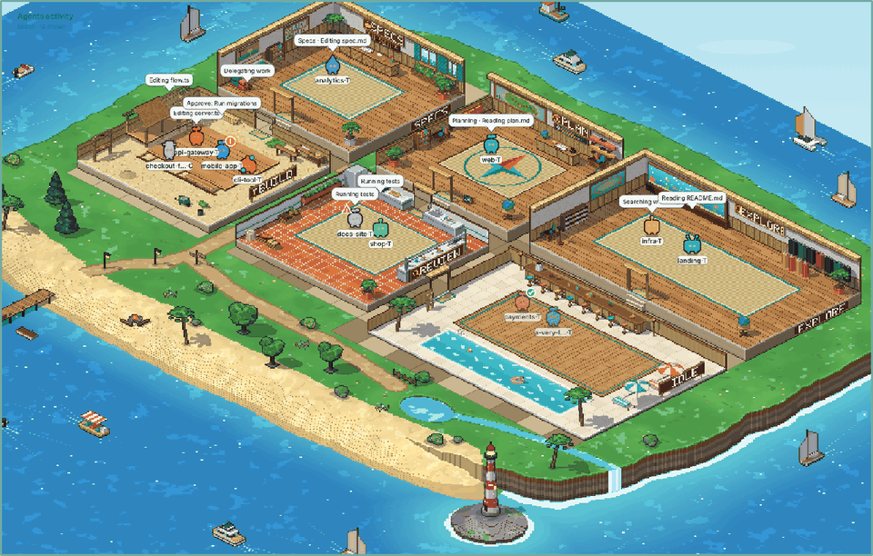

# Busybots

An isometric pixel-art board that shows what your coding agents are doing right now. Each Claude Code, Codex CLI, Gemini CLI, OpenCode, Cursor CLI or Conductor session is a little character that walks between rooms (Specs, Plan, Explore, Build, Test & Review, Idle) as its work changes, with a speech bubble saying what it's doing.



Four themes: **Island**, **Office**, **City** and **Space**.

> Status: early. Works on macOS and Linux; Windows should work but is less tested.

## Run

Requires **Node.js 22.5 or newer** (it uses Node's built-in SQLite). No other dependencies.

```bash
npx busybots               # starts the board and opens http://127.0.0.1:8765/
```

Then open **Settings** (top right, or http://127.0.0.1:8765/admin) to check that your agents were found. To keep it running in the background and start it at login, install it once with `npm install -g busybots` and run `busybots service install`.

From a clone instead: `git clone https://github.com/youmdingding/busybots.git && cd busybots && node bin/cli.js`.

| Command | What it does |
|---|---|
| `busybots` / `busybots start` | run the board and open it in your browser |
| `busybots serve` | same, without opening the browser |
| `busybots doctor` | check Node, your settings and every agent folder |
| `busybots status` | one pass of the watcher, printed as JSON |
| `busybots service install` | start the board at login (LaunchAgent on macOS, systemd user unit on Linux); `service uninstall` removes it |
| `busybots hook` | optional Claude Code hook, see [Status badges](#status-badges) |

Options: `--port N` (default 8765), `--no-open`. With `npx`, prefix them: `npx busybots doctor`. From a clone, run `node bin/cli.js <command>`.

Everything the board writes (settings, API token, logs, a copy of the current status) lives in a per-user folder, never in the repo: `~/Library/Application Support/busybots` on macOS, `$XDG_STATE_HOME/busybots` (default `~/.local/state/busybots`) on Linux, `%LOCALAPPDATA%\busybots` on Windows. Override with `BUSYBOTS_STATE`, or just the settings file with `BUSYBOTS_SETTINGS`.

## Rooms

Back row: **Specs → Plan → Explore** · Front row: **Build → Test & Review → Idle**.

- What an agent is doing (editing, running tests, reading, planning…) decides its room.
- Reading, searching and web lookups go to **Explore** — unless the current turn has already done other work, in which case reads stay with that work so implementing agents don't bounce between rooms.
- Room layout, labels, colours and the tool → room mapping live in `config.json`.

### Your rooms

**Settings → Rooms** lets you name and colour the six rooms the way you work ("Ship it", "QA", "Research"…) and choose where each kind of work goes:

- The name shows on the room's sign in every theme, in the legend under the board and in Today. Signs fit about 6 letters in big type; longer names use small letters or are cut at a word.
- The colour shows in Today and on the sign's letters.
- **Where each kind of work goes**: editing code, running tests and checks, reviewing, reading and searching, writing plans, writing specs, delegating to sub-agents and anything else, each to the room you pick (e.g. tests in Build instead of Test & Review). A skill or command with its own room still wins.

Changes show on an open board within 30 seconds.

### Skill-aware rooms

A turn started with a skill or slash command keeps that skill's room for the whole turn, even while its sub-agents read files and run commands — e.g. `/plan` stays in **Plan**, `/pr-review` in **Test & Review**, `/spec-kit` in **Specs**. The bubble is prefixed ("Planning · Running a command"). Add your own skills with `rules.skillAreas` (see Configuration).

### Your setup

Busybots also looks at what you have installed and places those skills for you:

- **Plugins** that are turned on in Claude Code, and their skills, commands and sub-agents.
- **Your own** skills, slash commands and sub-agents (`~/.claude/skills`, `commands`, `agents`), Codex prompts, and the commands in your recent projects' `.claude/commands`.
- **Workflow frameworks** in your recent projects: Spec Kit (`.specify`), Kiro specs (`.kiro/specs`), OpenSpec (`openspec/`), BMAD (`.bmad-core`), Task Master (`.taskmaster`), and Superpowers. Each one knows its own commands and files, e.g. `/speckit.tasks` goes to **Plan** and `requirements.md` counts as a spec.
- Anything else is placed by keywords in its name and description ("Run the smoke tests…" → **Test & Review**). Unclear ones are left alone.

**Settings → Your setup** lists everything found, the room each one sends an agent to and why. Pick a room to override it, or turn the whole thing off. Your choices win over `config.json`, which wins over what's detected. The scan only reads those folders and re-runs every 10 minutes (or **Scan again**); `busybots doctor` prints a summary.

## Settings

The **Settings** page (`/admin`) is where you tell the board where your agents keep their sessions. It checks each folder as you type ("Found — 2 live sessions" / "Folder not found") and saves to `settings.json` in your state folder (see [Run](#run)). The watcher re-reads it every poll, so changes show up within seconds — no restart.

| Agent | What to point it at | Default |
|---|---|---|
| Claude Code | folder containing `sessions/` and `projects/` — add several if you use more than one profile | `~/.claude` (or `$CLAUDE_CONFIG_DIR`) |
| Codex CLI | folder containing `sessions/` | `~/.codex` (or `$CODEX_HOME`) |
| Gemini CLI | its `.gemini` folder (contains `tmp/`) | `~/.gemini` (or `$GEMINI_CLI_HOME/.gemini`) |
| OpenCode | its data folder (contains `opencode.db`) | `~/.local/share/opencode` (or `$XDG_DATA_HOME/opencode`) |
| Cursor CLI *(beta)* | its `.cursor` folder (contains `chats/`) | `~/.cursor` |
| Conductor | its app database (macOS); **Auto** turns it on when the file exists | `~/Library/Application Support/com.conductor.app/conductor.db` |

It also sets the board's default theme, whether idle agents keep their last bubble, how often it updates, and **privacy mode**: for screen sharing or streaming, agents show as "Claude 1", "Codex 2"… with generic bubbles ("Working on code", "Running checks", "Needs you"), and no project names, paths, file names or agent text leave the watcher; the agent panel hides its transcript. Without a `settings.json` the defaults above are used.

### What each agent's files can tell the board

Claude Code is the richest source. The others are read from their session files, which record less:

| | Rooms & bubbles | Done badge | Stuck badge | "Needs you" badge | Agent panel transcript |
|---|---|---|---|---|---|
| Claude Code | ✓ | ✓ | ✓ | ✓ | ✓ (and reply box) |
| Codex CLI | ✓ | ✓ | ✓ | — | ✓ |
| Gemini CLI | ✓ ¹ | ✓ | ✓ | — | ✓ |
| OpenCode | ✓ | ✓ | ✓ | — | ✓ |
| Cursor CLI | ✓ ² | ✓ | ✓ | — | ✓ |

- None of these agents writes "waiting for your approval" to disk, so only Claude Code gets the **needs you** badge.
- Agents other than Claude Code appear while their files are changing and stay (idle) for the number of minutes set in Settings.
- ¹ Gemini CLI writes a tool call only once it has finished, so while a command runs the agent shows its last message, and a turn counts as finished after ~45 s of quiet.
- ² Cursor's CLI is closed source; its reader follows the layout documented by community tools and may need updating when Cursor changes it. The Cursor IDE's own chats aren't read.

### Adding another agent

Each agent has a small reader in `src/readers/<agent>.js` that translates its session files into the Claude-style events the watcher already understands (event helpers in `src/events.js`, registry in `src/readers/index.js`). The scenarios in `tests/scenarios/` describe real on-disk formats and the board output they must produce; add one for a new agent and run `npm test`. See `AGENTS.md` for the full checklist.

## Configuration

`config.json` (shipped with the board) holds the room layout (`areas`, `pathHubs`), the tool → room mapping (`activityAreas`) and default rules. Your own additions go in the `rules` section of your `settings.json`, so they survive updates:

```json
{
  "rules": {
    "skillAreas":   { "brainstorming": "specs", "writing-plans": "plan", "ship": "build" },
    "skillLabels":  { "brainstorming": "Brainstorming", "ship": "Shipping" },
    "phaseFiles":   { "plan": ["research.md", "data-model.md"], "spec": ["brief.md"] },
    "testCommands": ["just check", "make verify"],
    "autoDetect":   true,
    "workAreas":    { "tests": "build" }
  },
  "rooms": { "build": { "label": "Ship it", "tint": "#e0703a" } }
}
```

- `skillAreas` / `skillLabels` — extra skills or slash commands and the room / bubble prefix they get (built-in defaults cover common names like `plan`, `review`, `explore`).
- `phaseFiles` — file names that mean an agent is writing a plan or a spec.
- `testCommands` — extra commands that count as testing (Test & Review room).
- `autoDetect` — place skills from what's installed (see [Your setup](#your-setup)); `false` turns it off.
- `workAreas` — kind of work → room: `code`, `tests`, `review`, `reading`, `plans`, `specs`, `delegating`, `other`.
- `rooms` (top level) — your name (up to 24 characters) and colour for a room, by its key in `config.json`.

Both files are re-read every poll; a broken `settings.json` falls back to defaults.

## Status badges

The header shows a summary pill ("2 need you · 1 done"), and each agent can carry a badge:

- **!** (orange, pulsing) — *needs you*: a permission prompt, a question, or a plan waiting for approval.
- **✓** (green) — *done*: the last turn finished after editing files and you haven't replied yet.
- **⚠** (red) — *stuck*: 3+ failing tool calls in a row while still working.
- **orbiting dots** — *delegating*: live sub-agents.

Click the agent to see the badge spelled out at the top of its panel: what it's waiting for, when it finished, or how many errors in a row.

Detection is heuristic from the transcripts. For exact permission detection, add the `Notification` hook from `examples/claude-hooks.json` to your Claude Code settings (it runs `busybots hook`).

## Notifications

Know when an agent needs you without watching the board:

- **The tab** shows how many agents need you, "(2) Busybots", and a dot on its icon (orange: needs you, green: finished).
- **🔕 Notify** (top right) turns on desktop notifications when an agent starts needing you or finishes. They only appear while you're looking at something else; clicking one opens that agent's panel.
- **Settings → Board → Notifications** chooses which events, adds a sound, and can send them **when the board is closed** too (macOS and Linux; Busybots sends them itself if no board has been open for 15 seconds).

## Today

**Today** (top right) shows what each agent did today: time working in each room, time waiting for you, how often it finished, files it edited and tokens used. ‹ › goes back through the last 30 days. The agent panel shows the same for that conversation ("Today: 1h 20m working (Build 50m · Plan 20m) · 3 files · 1.2M tokens").

It's recorded while Busybots runs, in `history/` in your state folder, one file per day. Turn on privacy mode to hide project and file names there too.

**Tokens** are read from the agents' own transcripts: Claude Code (including its sub-agents) and Codex CLI. The panel shows the whole conversation's total, with input, cache and output in its tooltip. Busybots doesn't show a cost in dollars: prices change and many people pay a subscription.

## Agent panel

Click an agent to open its panel: the last 15 messages between you and the agent (with the tool steps in between, each with its date and time), **Open in …** (finds where the agent runs and brings it to the front, macOS: its iTerm or Terminal tab, the project's window in VS Code, Cursor, Windsurf or another app, its tmux pane, or Conductor) and, for idle terminal sessions, a prompt box that runs `claude --resume <id> -p "<prompt>"`.

Click ✎ next to the name to rename that conversation (it defaults to the folder name; **Use the default name** goes back). Click the agent's icon in the panel to give that conversation a different look: pick a character (its own, or a robot, cat, fox, frog, owl, octopus, mushroom, cactus, slime, alien, rocket, bunny, star, heart, crystal or bird) and one of 12 colours, then **Save**. The choice lasts for that conversation only; the agent's own icon stays visible as a small badge.

## Mini board

Keep an eye on your agents without giving them a whole window. **⧉ Pop out** (top right) puts the board in a small window you can park in a corner of the screen: just the rooms, bigger agents and badges, no labels. Click an agent there to open its panel in the main board, and **Bring it back** when you're done.

- **Chrome and Edge:** the small window stays on top of your other windows.
- **Safari and Firefox:** it opens as a small separate window instead.
- `http://127.0.0.1:8765/?mini=1` shows the mini board on its own, for a spare screen or an app that puts a web page on your desktop (such as Plash on macOS).

## Local API and security

The server binds **127.0.0.1** only, rejects other Host/Origin headers, and only serves the board's own files. Mutating routes need the `X-Board-Token` header (the board fetches it from `GET /api/token`; it's stored in your state folder).

- `GET /api/settings` — current settings (merged with defaults)
- `POST /api/settings` — save settings · `POST /api/settings/check` — test folders without saving
- `GET /api/session/<id>` — session meta (with today's activity and tokens) + last ~15 transcript items
- `GET /api/recap?day=YYYY-MM-DD` — what each agent did that day (default today)
- `GET /api/setup` — installed plugins, skills and frameworks and the room each skill gets (`?rescan=1` scans again)
- `POST /api/session/<id>/jump` — focus the session's window
- `POST /api/session/<id>/prompt` — resume an idle terminal session with a prompt
- `POST /api/session/<id>/name` — rename that conversation (`{"name": "Checkout rewrite"}`, or `null` for the folder name; up to 40 characters)
- `POST /api/session/<id>/icon` — pick an icon for that conversation (`{"icon": "icons/pick-cat-03.png"}`, or `null` for its own)

The status (`/status.json`, and `status.json` in your state folder) contains local paths, session names and short snippets of agent output — don't share it. The same goes for the daily files in `history/` (project and file names).

## Themes

Themes only change visuals. See `themes/README.md`. Theme art is generated by the scripts in `tools/city_props/` (custom isometric renderer) and `tools/gen_assets.py` / `tools/gen_icons.py` (Python with Pillow; only needed to change the art).

## Similar projects

Watching agents as pixel characters is a popular idea. What Busybots does differently:

- **Several agents, one board:** Claude Code, Codex CLI, Gemini CLI, OpenCode, Cursor CLI and Conductor, side by side.
- **Nothing to install into your agents:** it only reads the session files they already write (read-only; hooks are optional).
- **Rooms follow the work:** Specs, Plan, Explore, Build, Test & Review, Idle, including skill and slash-command aware turns, plus *needs you* / *done* / *stuck* badges.
- **Four themes**, zero dependencies, one `node` process.

Others worth a look: [Pixel Agents](https://github.com/pablodelucca/pixel-agents) (VS Code extension, an office for Claude Code terminals), [Claude Office Visualizer](https://github.com/paulrobello/claude-office) (web app, boss and employee sub-agents, Claude Code and OpenCode), [pixtuoid](https://github.com/IvanWng97/pixtuoid) (terminal dashboard, Claude Code and Codex), [Agentopolis](https://github.com/otniel-bit/agentopolis) (pixel city for Claude Code sessions), [pixel-agent-desk](https://github.com/Mgpixelart/pixel-agent-desk) (Electron app with usage analytics), [Claude Backstage](https://claudepluginhub.com/plugins/sebyul2-backstage) (Claude Code plugin with a task board).

## Development

```bash
npm test                     # watcher scenarios, readers, server contract, hook
node tests/visual/snapshots.mjs record /tmp/board-base   # before a rendering refactor…
node tests/visual/snapshots.mjs compare /tmp/board-base  # …and after: pixels must match
```

The visual snapshots need Playwright with Chromium (dev only, not a dependency). `node tools/readme-gif.mjs [theme]` re-records the README animation (also needs Python with Pillow). Guidelines for contributors and coding agents are in `AGENTS.md`.
